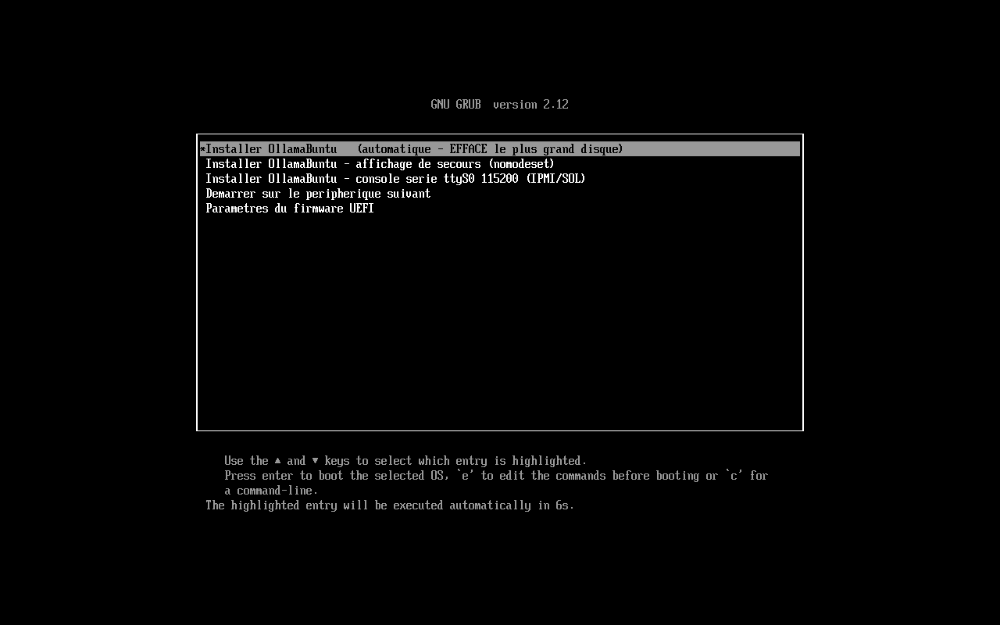
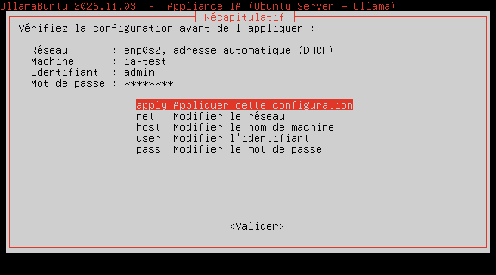
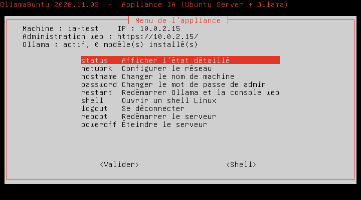

<p align="center"></p>

# OllamaBuntu

Générateur d'ISO pour une **appliance IA** : Ubuntu Server LTS + [Ollama](https://ollama.com), installable sur un
serveur physique ou une VM (BIOS et UEFI) **sans aucune question** pendant l'installation, avec une console
d'administration web, un menu console, et la même ISO pour **mettre à jour** une installation existante sans
rien perdre. Français et anglais.

Un seul point d'entrée construit l'ISO : `build.sh` (Linux, macOS, WSL2) ou `build.ps1` (Windows).

## Aperçu

| Menu de démarrage (UEFI) | Assistant du premier démarrage | Menu console |
|---|---|---|
|  |  |  |

Captures de démarrage obtenues sous QEMU (BIOS et UEFI) : `docs/assets/captures/`.

## Démarrage rapide

```sh
./build.sh                                  # télécharge Ubuntu Server et Ollama, produit ollamabuntu-<version>-amd64.iso
./build.sh ubuntu-24.04.3-live-server-amd64.iso    # avec une ISO Ubuntu déjà téléchargée
PRELOAD_MODELS="" ./build.sh                # sans modèle embarqué (ISO plus petite)
OB_LANG=en ./build.sh                       # appliance en anglais par défaut
DISK_ENCRYPTION=tpm ./build.sh              # disque chiffré (voir docs/CHIFFREMENT.md)
./build.sh --help                           # toutes les options
```

| Poste de construction | Comment |
|---|---|
| **Linux / WSL2** | `./build.sh` directement. Dépendances : `xorriso curl python3 tar zstd` (installées par `apt` si absentes) ; `gpgv` et `ubuntu-keyring` pour embarquer les paquets de sécurité avec vérification de signature. |
| **macOS** | `./build.sh` : le script se relance seul dans un conteneur Linux (Docker Desktop, OrbStack ou Colima). Les certificats racines du poste sont transmis au conteneur. |
| **Windows 10/11** | `powershell -ExecutionPolicy Bypass -File .\build.ps1` (Docker Desktop requis, en mode conteneurs Linux). Sans Git Bash ni WSL. Les certificats racines de Windows sont transmis au conteneur. |

L'ISO est produite dans le dossier courant ; le cache de téléchargement est dans `./ollamabuntu-build/` (ignoré par git).
Clé USB : Rufus en mode « DD », balenaEtcher ou `dd`. VM : monter l'ISO comme CD-ROM.

### Options (variables d'environnement ; sous Windows, paramètres de `build.ps1`)

| Variable | Défaut | Rôle |
|---|---|---|
| `UBUNTU_RELEASE` | `24.04` | Branche Ubuntu Server téléchargée |
| `OB_LANG` | `fr` | Langue par défaut de l'appliance (`fr` ou `en`) : menu de démarrage, assistant, console web |
| `DISK_ENCRYPTION` | `none` | `tpm` : disque chiffré (LUKS2) ; TPM2 si présent, sinon phrase de passe |
| `OLLAMA_VERSION` | `latest` | Version d'Ollama, ou une version précise (`v0.40.14`) |
| `OLLAMA_ARCHIVE` | (vide) | Archive `ollama-linux-amd64.tar.zst` déjà téléchargée |
| `PRELOAD_MODELS` | `llama3.2:3b` | Modèles embarqués dans l'ISO (`""` = aucun) |
| `INCLUDE_ROCM` | `0` | `1` : ajoute le module des GPU AMD (~1 Go) |
| `LOCALE`, `KEYBOARD`, `KEYBOARD_VARIANT`, `TIMEZONE` | `fr_FR.UTF-8`, `fr`, (vide), `Europe/Paris` | Réglages du système installé |
| `GRUB_TIMEOUT` | `20` | Secondes avant l'installation automatique |
| `OB_VERSION` | date et heure | Numéro de version (`AAAA.MM.JJ-HHMM`), comparé par GRUB pour proposer la mise à jour |
| `OB_BUILD_LANG` | `OB_LANG` | Langue des messages de construction |
| `EXTRA_CA_CERTS` | (vide) | Certificat racine PEM d'un proxy d'entreprise qui inspecte le HTTPS |
| `WORKDIR`, `OUTPUT` | `./ollamabuntu-build`, `./ollamabuntu-<version>-amd64.iso` | Dossier de travail et ISO produite (ignorés sous macOS et Windows) |

## Déroulé sur le serveur

1. **Démarrage sur l'ISO** : installation 100 % automatique (Subiquity), sans question ; Ollama, la console
   d'administration web et les modèles embarqués sont installés pendant l'installation, rien n'est téléchargé après.
2. **Premier démarrage** : assistant console (langue, réseau, nom de machine, identifiant, mot de passe), puis
   l'appliance est opérationnelle sur `https://<ip>/`. Avec `DISK_ENCRYPTION=tpm`, l'assistant gère aussi la clé de récupération.
3. **Mise à jour** : soit **depuis Internet** (console web > Système > Appliance > « Rechercher une mise à jour » : les versions
   publiées sur GitHub sont détectées, vérifiées par signature puis appliquées, sans ISO ; voir `docs/MISE-A-JOUR-EN-LIGNE.md`),
   soit en démarrant le serveur sur une ISO plus récente (GRUB propose « Mettre à jour » par défaut), ou depuis la console web / le menu
   console avec une ISO ou une clé USB connectée. Comptes, réglages, certificats et modèles sont conservés.

## Organisation du dépôt

```
build.sh              point d'entrée Linux / macOS / WSL2 (options, enchaînement des étapes)
build.ps1             lanceur Windows (PowerShell + Docker Desktop)
lib/                  étapes de construction, une responsabilité par fichier
  common.sh             variables, messages (traduits), téléchargement
  host.sh               détection de l'hôte, exécution dans Docker, test en VM QEMU
  prereqs.sh ubuntu.sh ollama.sh packages.sh
  rootfs.sh             assemble src/rootfs dans le tar embarqué dans l'ISO
  installer.sh          fin d'installation, mise à jour, fichier autoinstall
  grub.sh iso.sh        menu de démarrage, construction et vérification de l'ISO
  bundle.sh             archive de mise à jour en ligne (build.sh --bundle), signature Ed25519
  py/                   petits programmes Python appelés par les étapes
src/
  rootfs/               tout ce qui est copié dans le système installé (même arborescence)
  rootfs.modes          droits des fichiers qui ne sont pas en 0644
  installer/            late.sh (fin d'installation), update.sh (mise à jour), autoinstall-update.yaml
tools/i18n/             sources du catalogue de traduction anglais (le français est la langue source)
tools/release/          new-release.sh : crée le tag de version qui déclenche la publication (GitHub Actions)
.github/workflows/      ci.yml (contrôles à chaque envoi), release.yml (archive signée publiée dans une release)
tests/                  unit/ (portable) et bench/ (banc de l'auteur) ; voir tests/README.md
docs/                   ARCHITECTURE.md, CHIFFREMENT.md
```

## Modifier l'appliance

- **Ajouter ou changer un fichier de l'appliance** : le placer dans `src/rootfs/` au chemin qu'il aura sur le serveur.
  S'il doit être exécutable (ou en `0440`…), le déclarer dans `src/rootfs.modes`. La chaîne `@@OB_VERSION@@` y est remplacée
  par le numéro de version à la construction.
- **Traduire** : français en source ; ajouter la phrase dans un fichier de `tools/i18n/cat_*.py` (phrase exacte, ou modèle
  à variables `{1}`…), puis `make i18n`. `make i18n-check` vérifie que le catalogue est à jour. Un même catalogue sert la console web,
  l'assistant, le menu console, la bannière, le menu de démarrage et les messages de construction.
- **Vérifier** : `make lint` (shellcheck), `make test` (tests portables) et `make test-ui` (console web, jsdom requis).
- **Publier une version** pour la mise à jour en ligne : `tools/release/new-release.sh "notes"` (voir `docs/MISE-A-JOUR-EN-LIGNE.md`).

## Sécurité

- Ubuntu et les paquets embarqués sont vérifiés (sommes SHA-256, signatures Canonical via `gpgv`) ; Ollama par sa somme SHA-256.
  Rien n'est téléchargé au premier démarrage.
- Pare-feu `nftables` (entrée refusée par défaut, anti-verrouillage), durcissement SSH et noyau, mises à jour de sécurité automatiques.
- Console web : HTTPS, sessions, PBKDF2, anti-force brute, protection CSRF, CSP, aucune fenêtre système ; API Ollama publiable
  avec clés (empreintes seules conservées) et politique d'usage de l'IA appliquée par le routeur.
- Mise à jour en ligne : archive signée (Ed25519) vérifiée avant toute application ; sommes SHA-256, contenu et version contrôlés ; HTTPS vers GitHub seulement.
- Ne **jamais** versionner d'ISO, de clés ou de mots de passe : `.gitignore` exclut les produits de construction et la clé de signature (`.secrets/`).

## Limites connues

- L'ISO produite est une ISO **x86-64** pour serveurs, même quand elle est construite sur un Mac Apple Silicon.
- Le chiffrement du disque n'a pas été validé sur une installation réelle ; voir `docs/CHIFFREMENT.md`.
- Le banc de régression (`tests/bench/`) n'est pas portable ; seuls les tests de `tests/unit/` le sont.

## Licence

OllamaBuntu est distribué sous licence **Apache 2.0** (voir `LICENSE` et `NOTICE`). Les composants libres embarqués (Ubuntu, Ollama, etc.)
gardent leurs propres licences : ils sont listés dans `src/rootfs/usr/local/lib/ollamabuntu/admin/credits.json`, d'où est généré
`OPEN-SOURCE.md` à chaque construction.
